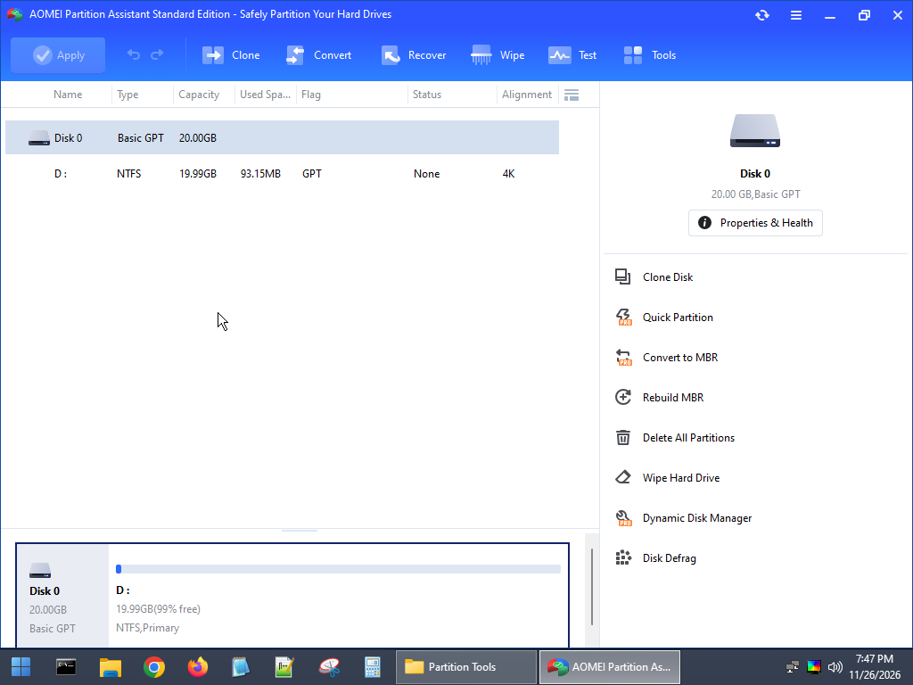
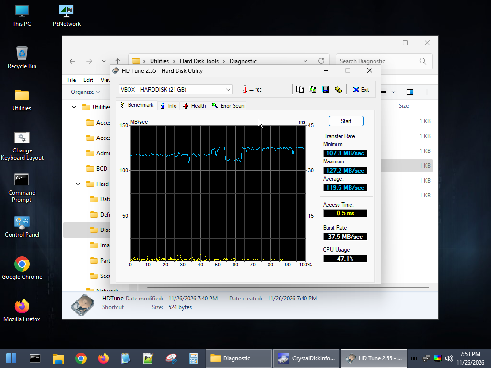

# Laudo Técnico de Armazenamento – Hiren's BootCD PE v1.0.8

* **Técnico Responsável:** Douglas Henrique de Brito
* **Data da Execução:** 26/11/2026
* **VM Utilizada:** `HBCD-v1.0.8`

---

## 1. Particionamento e Formatação (AOMEI / DiskGenius)

| Parâmetro Configurado | Valor Aplicado |
| :--- | :--- |
| **Disco Alvo** | Disk 1 (20 GB VDI) |
| **Tabela de Partição** | GPT |
| **Sistema de Arquivos** | NTFS |
| **Letra Atribuída** | `D:\` |

**Evidência 1 – Gerenciador de Partições:**

---

## 2. Análise de Saúde S.M.A.R.T. (CrystalDiskInfo)

* **O CrystalDiskInfo exibiu os atributos S.M.A.R.T. do disco de 20 GB?** (Sim / Não)
Não
* **Justificativa Técnica:** [Explique por que o hipervisor/disco virtual VDI oculta ou emula os sensores físicos S.M.A.R.T. em comparação a um HD/SSD real na bancada]
Pois os discos virtuais não possuem sensores físicos de temperatura, contagem de setores realocados ou ciclos de energia fazendo com que os dados S.M.A.R.T não existam ou sejam ocultados.

---

## 3. Teste de Desempenho de Leitura (HD Tune Benchmark)

| Métrica Aferida | Resultado Obtido |
| :--- | :--- |
| **Taxa Mínima (Minimum)** | 107.8 MB/s |
| **Taxa Máxima (Maximum)** | 127.2 MB/s |
| **Taxa Média (Average)** | 119.5 MB/s |
| **Tempo de Acesso (Access Time)** | 0.5 ms |

**Evidência 2 – Gráfico do Benchmark:**
