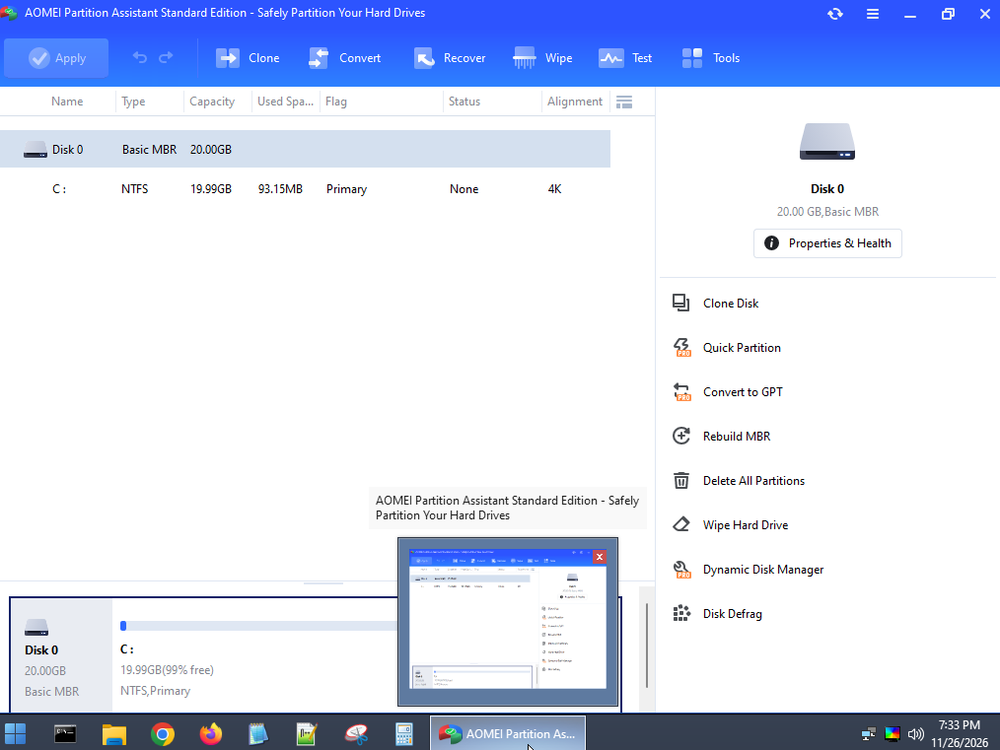
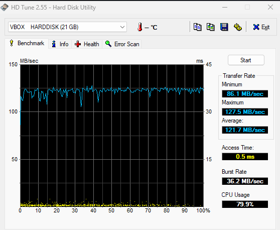

# Laudo Técnico de Armazenamento – Hiren's BootCD PE v1.0.8

* **Técnico Responsável:** Felipe Alves Soares
* **Data da Execução:** 16/06/2026
* **VM Utilizada:** `HBCD-v1.0.8`

---

## 1. Particionamento e Formatação (AOMEI / DiskGenius)

| Parâmetro Configurado | Valor Aplicado |
| :--- | :--- |
| **Disco Alvo** | Disk 1 (20 GB VDI) |
| **Tabela de Partição** | GPT |
| **Sistema de Arquivos** | NTFS |
| **Letra Atribuída** | `D:\` |

**Evidência 1 – Gerenciador de Partições:**

---

## 2. Análise de Saúde S.M.A.R.T. (CrystalDiskInfo)

* **O CrystalDiskInfo exibiu os atributos S.M.A.R.T. do disco de 20 GB?** (Sim / Não) Não, tivemos que utilizar HDDisk
* **Justificativa Técnica:** Porque um arquivo de disco virtual (como um .vdi ou .vmdk) é apenas um arquivo de dados comum, não um componente eletrônico físico.

---

## 3. Teste de Desempenho de Leitura (HD Tune Benchmark)

| Métrica Aferida | Resultado Obtido |
| :--- | :--- |
| **Taxa Mínima (Minimum)** | 86.1 MB/s |
| **Taxa Máxima (Maximum)** | 127.5 MB/s |
| **Taxa Média (Average)** | 121.7 MB/s |
| **Tempo de Acesso (Access Time)** | 0.5 ms |

**Evidência 2 – Gráfico do Benchmark:**

