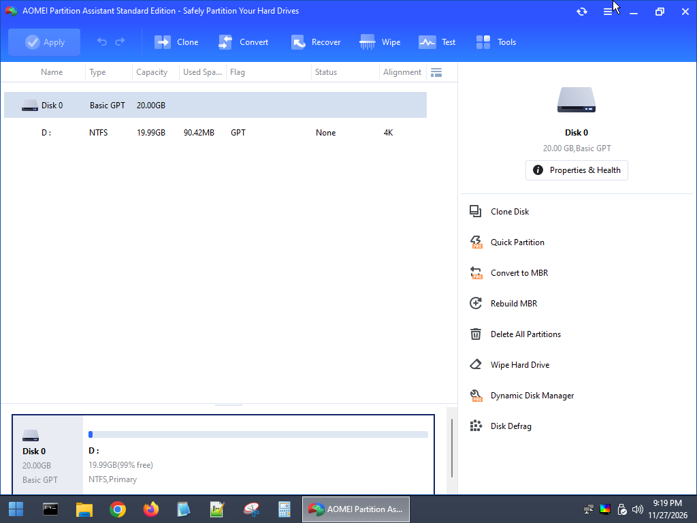
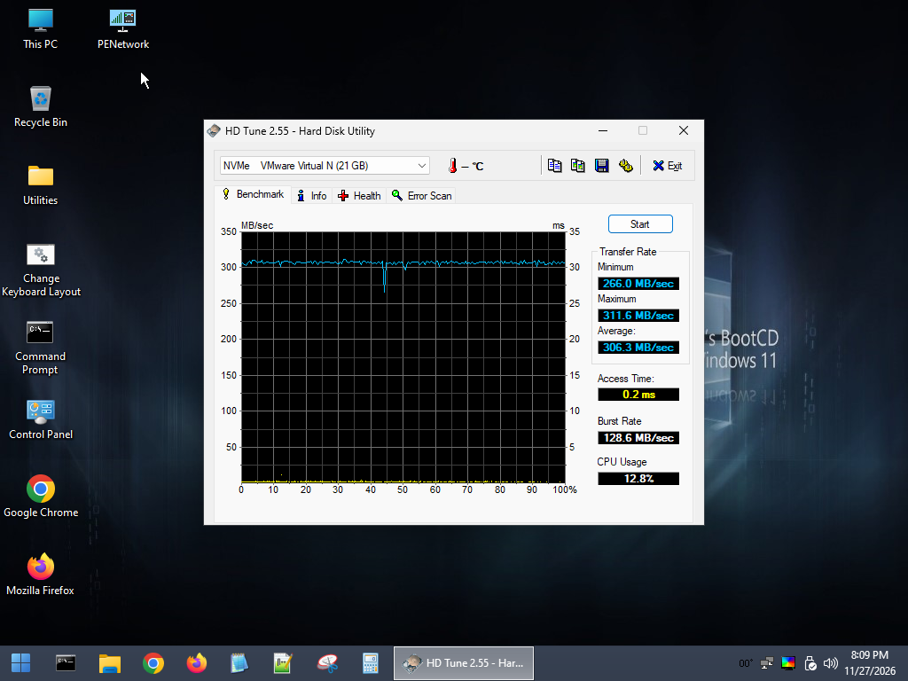

# Laudo Técnico de Armazenamento – Hiren's BootCD PE v1.0.8

* **Técnico Responsável:** Giovani Do Nascimento Fernandes
* **Data da Execução:** 27/11/2026
* **VM Utilizada:** `HBCD-v1.0.8`

---

## 1. Particionamento e Formatação (AOMEI / DiskGenius)

| Parâmetro Configurado | Valor Aplicado |
| :--- | :--- |
| **Disco Alvo** | Disk 1 (20 GB VDI) | Disk 0 (20 GB MBR)
| **Tabela de Partição** | GPT | NTFS
| **Sistema de Arquivos** | NTFS | NTFS
| **Letra Atribuída** | `D:\` | ´D:\` 

**Evidência 1 – Gerenciador de Partições:**

---

## 2. Análise de Saúde S.M.A.R.T. (CrystalDiskInfo)

* **O CrystalDiskInfo exibiu os atributos S.M.A.R.T. do disco de 20 GB?** (Sim / Não) | Sim
* **Justificativa Técnica:** O hipervisor simula uma máquina física, com isso o VDI abstrai os softwares e não os controla diretamente.

---

## 3. Teste de Desempenho de Leitura (HD Tune Benchmark)

| Métrica Aferida | Resultado Obtido |
| :--- | :--- |
| **Taxa Mínima (Minimum)** | 266.0 MB/s |
| **Taxa Máxima (Maximum)** | ___ MB/s |
| **Taxa Média (Average)** | ___ MB/s |
| **Tempo de Acesso (Access Time)** | ___ ms |

**Evidência 2 – Gráfico do Benchmark:**
