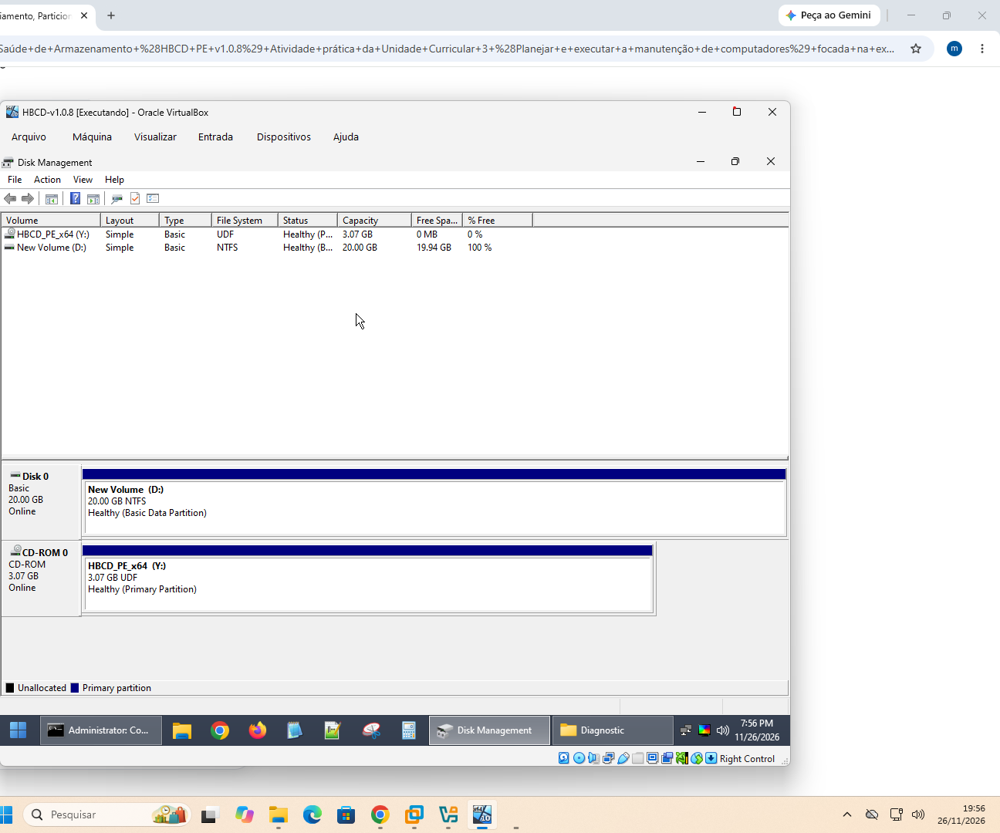
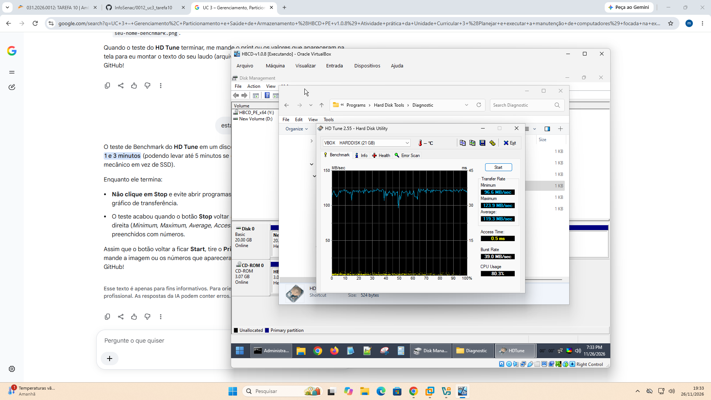

# Laudo Técnico de Armazenamento – Hiren's BootCD PE v1.0.8

* **Técnico Responsável:** Marcos Paulo
* **Data da Execução:** 26/11/2026
* **VM Utilizada:** HBCD-v1.0.8

## 1. Particionamento e Formatação (AOMEI / DiskGenius)

| Parâmetro Configurado | Valor Aplicado |
| :--- | :--- |
| **Disco Alvo** | Disk 0 / Secundário (20 GB VDI) |
| **Tabela de Partição** | GPT |
| **Sistema de Arquivos** | NTFS |
| **Letra Atribuída** | `D:\` |

**Evidência 1 – Gerenciador de Partições:**

---

## 2. Análise de Saúde S.M.A.R.T. (CrystalDiskInfo)

* **O CrystalDiskInfo exibiu os atributos S.M.A.R.T. do disco de 20 GB?** Não
* **Justificativa Técnica:** Em ambientes virtualizados (como o Oracle VirtualBox utilizando discos virtuais `.vdi`), o hipervisor atua como uma camada de abstração entre o sistema operacional convidado e o hardware físico da máquina hospedeira, emulando uma controladora de armazenamento virtual genérica. Como o protocolo S.M.A.R.T. (*Self-Monitoring, Analysis and Reporting Technology*) depende da comunicação direta com a placa lógica e os sensores físicos de um HD ou SSD real na bancada (como temperatura, horas ligado, contagem de setores realocados e desgaste da memória NAND), esses comandos de baixo nível não são repassados ao disco virtual, fazendo com que o utilitário exiba o status como desconhecido (*Unknown*) e sem atributos detalhados.

---

## 3. Teste de Desempenho de Leitura (HD Tune Benchmark)

| Métrica Aferida | Resultado Obtido |
| :--- | :--- |
| **Taxa Mínima (Minimum)** | 96.6 MB/s |
| **Taxa Máxima (Maximum)** | 123.9 MB/s |
| **Taxa Média (Average)** | 119.3 MB/s |
| **Tempo de Acesso (Access Time)** | 0.5 ms |

**Evidência 2 – Gráfico do Benchmark:**

